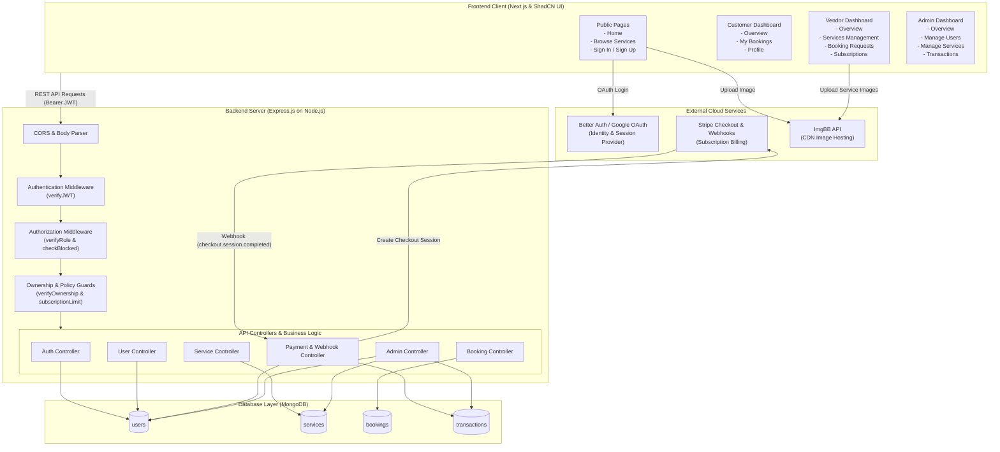
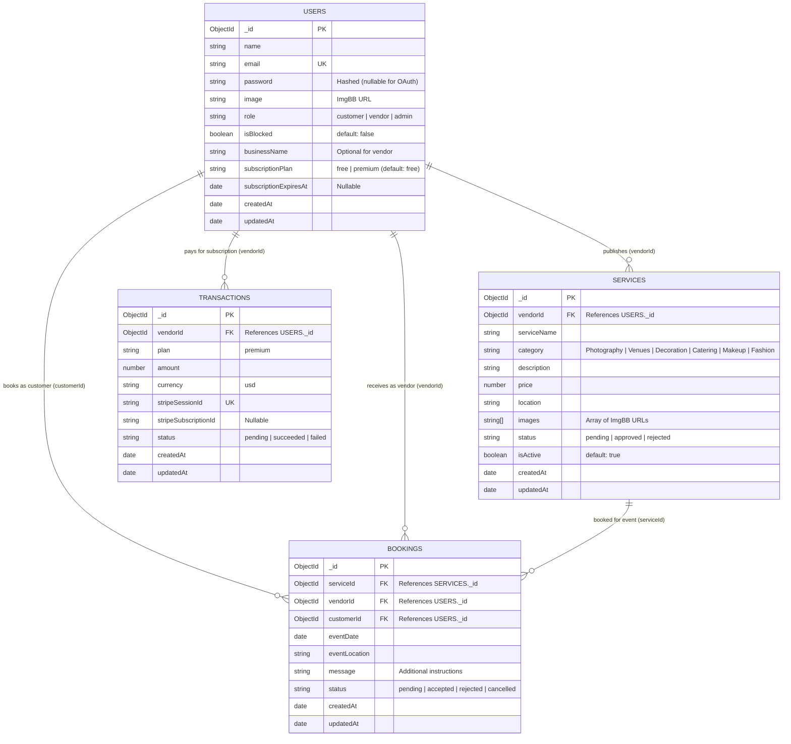
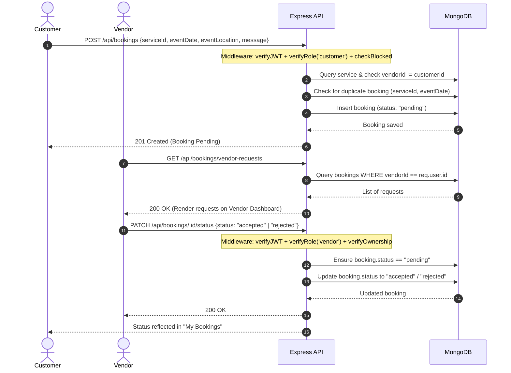
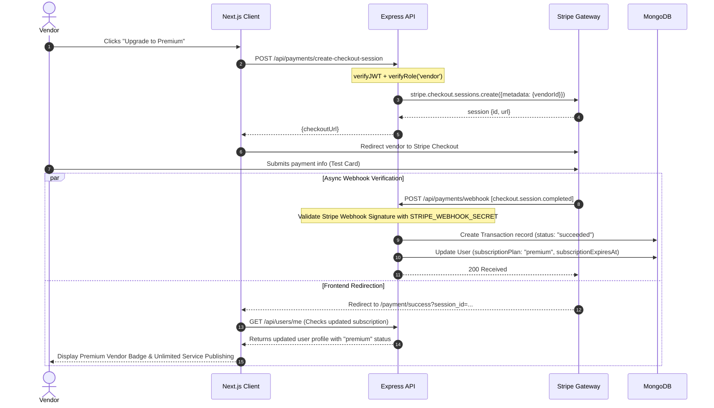

Analyzed Assignment 9-Category_004.md:L1-799
Ran list workspace directory contents
Ran list non-node_modules files
Ran list models folder
Analyzed package.json:L1-27
Ran check parent directory

# System Architecture & Specification: WedPlan Platform

Based on [Assignment 9-Category_004.md](<file:///d:/projects/wed-plan/wed-plan-backend/Assignment%209-Category_004.md>), here is the comprehensive architectural blueprint for the **WedPlan - Wedding Planning Platform**, covering the high-level system architecture, entity relationships, REST API design, role-based access control (RBAC), and core workflow sequences.

---

## 1. High-Level System Architecture

WedPlan is designed as a decoupled multi-tier architecture featuring a **Next.js client** (frontend UI + SSR/SSG), an **Express.js API Gateway & Application Server**, a **MongoDB database cluster**, and external cloud services for authentication, payments, and media storage.

---

## 2. Entity-Relationship Diagram (ERD)

The database schema utilizes MongoDB with 4 primary collections: `users`, `services`, `bookings`, and `transactions`.

### Relational Constraints & Business Rules

* **Free Tier Limit:** Vendors with `subscriptionPlan = 'free'` can have at most **3 active/approved services** (`isActive: true`, `status: 'approved'`).
* **Booking Isolation:**
  * Customers cannot book a service where `vendorId == customerId`.
  * Unique constraint on active bookings: `(serviceId, eventDate)` where `status IN ['pending', 'accepted']`.
* **State Immutability:**
  * Once a booking transitions to `accepted`, `rejected`, or `cancelled`, its state is final.
  * Customers can only cancel when status is `pending`.

---

## 3. Role-Based Access Control (RBAC) & Permission Matrix

The application enforces a multi-tier permission model. Server-side middleware verifies tokens, user block status, specific roles, and resource ownership.

| Feature / Action                            |       Public / Guest       | Customer |     Vendor (Free)     |     Vendor (Premium)     | Admin | Server Guards & Conditions                                                     |
| :------------------------------------------ | :------------------------: | :------: | :-------------------: | :----------------------: | :---: | :----------------------------------------------------------------------------- |
| **View Home & Featured Services**     |             ✅             |    ✅    |          ✅          |            ✅            |  ✅  | Public                                                                         |
| **Browse / Search / Filter Services** |             ✅             |    ✅    |          ✅          |            ✅            |  ✅  | Public (`status: 'approved'`, `isActive: true`)                            |
| **View Service Details**              | ❌ *(Redirect to login)* |    ✅    |          ✅          |            ✅            |  ✅  | `verifyJWT`, `checkBlocked`                                                |
| **Submit Booking Request**            |             ❌             |    ✅    |          ❌          |            ❌            |  ❌  | `verifyJWT`, `role: customer`, `customerId != vendorId`                  |
| **View Own Bookings**                 |             ❌             |    ✅    |          ❌          |            ❌            |  ❌  | `verifyJWT`, `role: customer`, filter `customerId = req.user.id`         |
| **Cancel Pending Booking**            |             ❌             |    ✅    |          ❌          |            ❌            |  ❌  | `verifyJWT`, `role: customer`, `status == pending`, ownership check      |
| **Create Service Listing**            |             ❌             |    ❌    | ✅ *(Max 3 active)* |    ✅ *(Unlimited)*    |  ❌  | `verifyJWT`, `role: vendor`, `subscriptionLimitCheck`                    |
| **Update / Delete Own Service**       |             ❌             |    ❌    |          ✅          |            ✅            |  ❌  | `verifyJWT`, `role: vendor`, ownership check (`vendorId == req.user.id`) |
| **View Vendor Booking Requests**      |             ❌             |    ❌    |          ✅          |            ✅            |  ❌  | `verifyJWT`, `role: vendor`, filter `vendorId = req.user.id`             |
| **Accept / Reject Booking**           |             ❌             |    ❌    |          ✅          |            ✅            |  ❌  | `verifyJWT`, `role: vendor`, `status == pending`, ownership check        |
| **Initiate Stripe Subscription**      |             ❌             |    ❌    |          ✅          | ❌ *(Already premium)* |  ❌  | `verifyJWT`, `role: vendor`                                                |
| **Manage Users (Block / Unblock)**    |             ❌             |    ❌    |          ❌          |            ❌            |  ✅  | `verifyJWT`, `role: admin`                                                 |
| **Review Services (Approve/Reject)**  |             ❌             |    ❌    |          ❌          |            ❌            |  ✅  | `verifyJWT`, `role: admin`                                                 |
| **Delete Inappropriate Service**      |             ❌             |    ❌    |          ❌          |            ❌            |  ✅  | `verifyJWT`, `role: admin`                                                 |
| **View Platform Transactions**        |             ❌             |    ❌    |          ❌          |            ❌            |  ✅  | `verifyJWT`, `role: admin`                                                 |
| **Update Own Profile**                |             ❌             |    ✅    |          ✅          |            ✅            |  ✅  | `verifyJWT`, cannot self-modify `role` or `subscriptionPlan`             |
| **Access Other Role's Dashboard**     |             ❌             |    ❌    |          ❌          |            ❌            |  ❌  | Forbidden (Returns HTTP 403)                                                   |
| **Blocked User Access**               |             ❌             |    ❌    |          ❌          |            ❌            |  ❌  | `checkBlocked` middleware rejects with HTTP 403                              |

---

## 4. API Architecture & Endpoint Specification

All protected endpoints require the HTTP header:
`Authorization: Bearer <JWT_TOKEN>`

### 4.1 Authentication & Profile (`/api/auth` & `/api/users`)

| Method    | Endpoint             | Access Role   | Description                                                                  | HTTP Status               |
| :-------- | :------------------- | :------------ | :--------------------------------------------------------------------------- | :------------------------ |
| `POST`  | `/api/auth/signup` | Public        | Register customer or vendor (Admin creation restricted)                      | `201 Created` / `400` |
| `POST`  | `/api/auth/signin` | Public        | Login with credentials; returns JWT token + user profile                     | `200 OK` / `401`      |
| `POST`  | `/api/auth/google` | Public        | Google OAuth token verification and account linking                          | `200 OK` / `400`      |
| `GET`   | `/api/users/me`    | Authenticated | Retrieve current user profile and active subscription details                | `200 OK` / `401`      |
| `PATCH` | `/api/users/me`    | Authenticated | Update profile (`name`, `image`, `businessName`). Role changes blocked | `200 OK` / `400`      |

### 4.2 Services (`/api/services`)

| Method     | Endpoint                      | Access Role    | Description                                                                   | HTTP Status                    |
| :--------- | :---------------------------- | :------------- | :---------------------------------------------------------------------------- | :----------------------------- |
| `GET`    | `/api/services`             | Public         | Search/filter/sort approved active services (pagination supported)            | `200 OK`                     |
| `GET`    | `/api/services/featured`    | Public         | Fetch top 6 featured approved services for homepage                           | `200 OK`                     |
| `GET`    | `/api/services/:id`         | Authenticated  | Get full service details by ID with vendor info                               | `200 OK` / `404`           |
| `POST`   | `/api/services`             | Vendor         | Add new service. Default status: `pending`. Checks 3-service limit for free | `201 Created` / `403`      |
| `GET`    | `/api/services/my-services` | Vendor         | Fetch all services belonging to the authenticated vendor                      | `200 OK`                     |
| `PATCH`  | `/api/services/:id`         | Vendor         | Update vendor's own service (re-verifies ownership)                           | `200 OK` / `403` / `404` |
| `DELETE` | `/api/services/:id`         | Vendor / Admin | Soft delete or remove service (Vendor must own it; Admin has master)          | `200 OK` / `403`           |

### 4.3 Bookings (`/api/bookings`)

| Method    | Endpoint                          | Access Role | Description                                                                          | HTTP Status                    |
| :-------- | :-------------------------------- | :---------- | :----------------------------------------------------------------------------------- | :----------------------------- |
| `POST`  | `/api/bookings`                 | Customer    | Create booking request (`eventDate`, `location`, `message`). Checks duplicates | `201 Created` / `400`      |
| `GET`   | `/api/bookings/my-bookings`     | Customer    | Fetch bookings submitted by current customer                                         | `200 OK`                     |
| `PATCH` | `/api/bookings/:id/cancel`      | Customer    | Cancel pending booking (immutable if accepted/rejected)                              | `200 OK` / `400` / `403` |
| `GET`   | `/api/bookings/vendor-requests` | Vendor      | Fetch booking requests for current vendor's services                                 | `200 OK`                     |
| `PATCH` | `/api/bookings/:id/status`      | Vendor      | Accept or reject pending booking request (`status: 'accepted' \| 'rejected'`)       | `200 OK` / `400` / `403` |

### 4.4 Payments & Subscriptions (`/api/payments`)

| Method   | Endpoint                                  | Access Role     | Description                                                           | HTTP Status          |
| :------- | :---------------------------------------- | :-------------- | :-------------------------------------------------------------------- | :------------------- |
| `POST` | `/api/payments/create-checkout-session` | Vendor          | Initiates Stripe Checkout Session for Premium upgrade                 | `200 OK` / `400` |
| `POST` | `/api/payments/webhook`                 | Public (Stripe) | Stripe webhook endpoint verifying signature & activating subscription | `200 OK` / `400` |

### 4.5 Admin Control (`/api/admin`)

| Method    | Endpoint                           | Access Role | Description                                                         | HTTP Status          |
| :-------- | :--------------------------------- | :---------- | :------------------------------------------------------------------ | :------------------- |
| `GET`   | `/api/admin/overview`            | Admin       | Aggregate dashboard counts (users, vendors, services, transactions) | `200 OK`           |
| `GET`   | `/api/admin/users`               | Admin       | List, search (name/email), and filter registered users by role      | `200 OK`           |
| `PATCH` | `/api/admin/users/:id/block`     | Admin       | Block or unblock a user (`isBlocked: boolean`)                    | `200 OK` / `404` |
| `GET`   | `/api/admin/services`            | Admin       | List all submitted services (pending, approved, rejected)           | `200 OK`           |
| `PATCH` | `/api/admin/services/:id/status` | Admin       | Moderate service status (`approved`, `rejected`, `pending`)   | `200 OK` / `400` |
| `GET`   | `/api/admin/transactions`        | Admin       | View audit log of all Stripe subscription transactions              | `200 OK`           |

---

## 5. Core Process Flow Diagrams

### 5.1 Booking Request & Decision Lifecycle

### 5.2 Stripe Subscription & Webhook Upgrade Flow

---

## 6. Backend Implementation Checklist

To align your Express server structure in `wed-plan-backend` with this design:

1. **Middlewares:**
   - `auth.middleware.js`: Validates JWT, extracts `req.user`.
   - `role.middleware.js`: Compares `req.user.role` with allowed roles; checks `req.user.isBlocked`.
   - `subscription.middleware.js`: Counts active services (`status: 'approved'`) for vendors on the `free` plan before allowing `POST /api/services`.
2. **Models:**
   - Define Mongoose schemas for `User.js`, `Service.js`, `Booking.js`, and `Transaction.js` matching the ERD field specifications.
3. **Stripe Webhook:**
   - Ensure the webhook route (`/api/payments/webhook`) uses `express.raw({type: 'application/json'})` so Stripe's HMAC signature validation succeeds.
